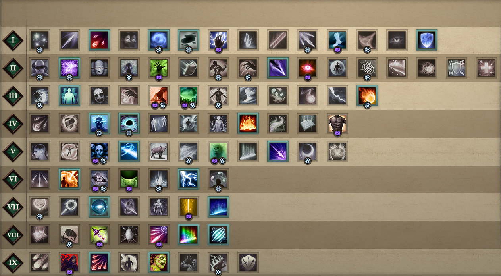

# 永恒之柱2 · 法术图谱

《永恒之柱2：死火》(Pillars of Eternity II: Deadfire) 的法术图鉴网页。

按法术等级（I–IX）排列全部 **102** 个法术，鼠标悬停即可查看该法术的完整说明图，点击图标可放大查看。

## ✨ 特性

- 按等级分行展示，左侧为 I–IX 罗马数字菱形徽记
- 以法术图标网格排列，悬停高亮并显示名称
- **悬停显示详细图**：光标旁浮出法术的完整说明截图
- **点击放大**：全屏查看，点击任意处或按 `Esc` 关闭
- 纯静态页面，无需服务器、无需联网，双击 `index.html` 即可打开

## 🖼 预览



## 📁 目录结构

```
.
├── index.html                  # 页面结构
├── styles.css                  # 样式
├── app.js                      # 交互逻辑
├── data.js                     # 法术数据（等级 / 名称 / 图标 / 说明图路径）
├── images/
│   ├── level-1/                # 1 级法术
│   │   ├── <法术名>icon.png     # 图标（缩略图）
│   │   └── <法术名>.webp        # 详细说明图
│   ├── level-2/
│   └── ... level-9/
├── docs/
│   └── 游戏内法术表示意图.png     # 设计参考图
├── README.md
├── .gitignore
└── .gitattributes
```

## 🚀 使用

1. 克隆或下载本仓库
2. 双击 `index.html`（或拖入浏览器）即可

无需构建、无需依赖。

## 🗂 数据格式

法术数据集中在 `data.js`，每一项形如：

```js
window.SPELLS = [
  {
    "level": 1,
    "name": "冰雾术",
    "icon": "images/level-1/冰雾术icon.png",
    "detail": "images/level-1/冰雾术.webp"
  },
  // ...
];
```

- `level`：法术等级（1–9）
- `name`：法术名称
- `icon`：列表用缩略图
- `detail`：悬停/点击时展示的说明图

新增法术时，把图标与说明图放进对应 `images/level-N/` 目录，并在 `data.js` 中追加一条即可。

## ⚖️ 版权声明

本项目为**非商业性粉丝作品**，仅用于学习与交流。

- 游戏名称、法术名称、图标、截图等素材的版权归 **Obsidian Entertainment** 及《永恒之柱2：死火》(Pillars of Eternity II: Deadfire) 各自权利人所有。
- 本仓库中的素材均截取自游戏，非原创。
- 如有侵权，请联系删除。

代码部分可自由参考使用。
